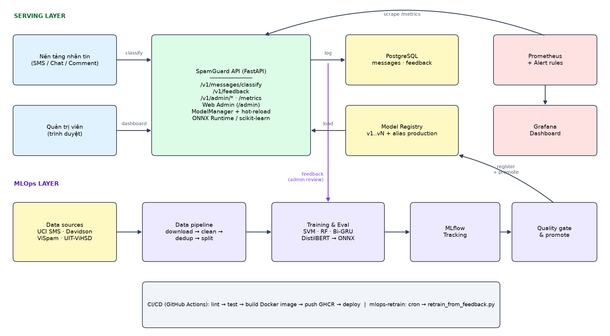

# SpamGuard – Hệ thống lọc Spam & Tin nhắn độc hại

**Smart Anti-Spam & Malicious Content Filtering System** – Đề tài 12, học phần *Phát triển các hệ thống thông minh* (INT14151), Nhóm 04.

| Thành viên | MSSV | Vai trò |
|---|---|---|
| Phạm Vương Mạnh (trưởng nhóm) | K24DTCN073 | Quản lý dự án, kiến trúc hệ thống, MLOps (registry, feedback loop, CI/CD) |
| Nguyễn Quốc Cường | K24DTCN045 | Dữ liệu: thu thập, làm sạch, EDA; mô hình SVM & Random Forest |
| Nguyễn Hữu Hoà | K24DTCN056 | Học sâu: Bi-GRU, DistilBERT, export ONNX, đánh giá |
| Nguyễn Vũ Thắng | K24DTCN091 | API Service, Web Admin, Docker, Monitoring, kiểm thử & load test |

## 1. Bài toán
Phân loại tin nhắn ngắn (SMS, chat, bình luận) **song ngữ Anh – Việt** thành 3 lớp:
`ham` (hợp lệ) · `spam` (rác/quảng cáo/lừa đảo) · `toxic` (xúc phạm/thù ghét). API trả về nhãn,
xác suất và hành động `allow | review | block`.

## 2. Kiến trúc



```
PhamManh/
├── configs/params.yaml          # toàn bộ siêu tham số + ngưỡng nghiệp vụ
├── src/spamguard/               # thư viện lõi (dùng chung train & serve)
│   ├── data/                    # download.py, build_dataset.py
│   ├── models/                  # classical.py (SVM, RF), bigru.py, distilbert.py
│   ├── text_preprocessing.py    # chuẩn hoá văn bản (chống training-serving skew)
│   ├── inference.py             # predictor runtime: ONNX Runtime / scikit-learn
│   ├── evaluation.py            # metric + đo latency trên artifact serving
│   ├── registry.py              # Model Registry (version bất biến + alias production)
│   └── training.py              # train → export → evaluate → MLflow → register
├── services/api/app/            # FastAPI: lọc tin, feedback, admin API, /metrics
├── admin-web/                   # Web Admin (HTML/JS + Chart.js), phục vụ tại /admin
├── scripts/                     # train_all, retrain_from_feedback, simulate_traffic, make_figures
├── monitoring/                  # Prometheus + alert rules + Grafana dashboard
├── docker/ + docker-compose.yml # api, postgres, mlflow, prometheus, grafana, retrainer
├── .github/workflows/           # ci-cd.yml, mlops-retrain.yml
├── loadtest/locustfile.py       # load test
└── tests/                       # pytest (unit + API)
```

## 3. Chạy nhanh (local)
```bash
make setup          # tạo .venv, cài requirements-dev.txt
make data           # tải UCI SMS, Davidson, ViSpamReviews, UIT-ViHSD → data/processed
make train          # train + so sánh 4 model, promote champion → models/registry
make figures        # biểu đồ vào reports/figures
make serve          # API: http://localhost:8000/docs · Admin: http://localhost:8000/admin
make simulate       # bơm 1.500 tin + mô phỏng admin review
make retrain        # 1 vòng feedback loop (retrain → gate → promote → API tự hot-reload)
make test lint
```
Admin token mặc định khi chạy local: `admin-dev-token` (đặt `ADMIN_TOKEN` khi triển khai thật).

## 4. Chạy bằng Docker
```bash
cp .env.example .env            # đổi mật khẩu/token
make train                      # cần models/registry trước khi chạy API
docker compose up -d --build    # api:8000, mlflow:5000, prometheus:9090, grafana:3000
docker compose --profile mlops up -d retrainer   # bật job retrain định kỳ
```

## 5. API chính
| Method | Endpoint | Mô tả |
|---|---|---|
| POST | `/v1/messages/classify` | `{text, channel, sender_id}` → `{label, confidence, action, scores, model_version}` |
| POST | `/v1/messages/classify-batch` | tối đa 100 tin/lần |
| POST | `/v1/feedback` | người dùng báo nhãn sai |
| GET | `/v1/admin/stats` | thống kê cho dashboard (cần `X-Admin-Token`) |
| GET/POST | `/v1/admin/messages`, `/v1/admin/messages/{id}/review` | tra cứu, gán nhãn |
| GET/POST | `/v1/admin/models`, `/v1/admin/models/{v}/promote` | registry, promote/rollback |
| GET | `/health`, `/ready`, `/metrics` | vận hành |

## 6. Kết quả so sánh mô hình (tập test 5.080 tin, CPU)
| Mô hình | Macro-F1 | F1 EN | F1 VI | ROC-AUC | p95 (ms) | Size (MB) |
|---|---|---|---|---|---|---|
| SVM (TF-IDF) | 0.837 | 0.942 | 0.787 | 0.954 | 1.2 | 9.5 |
| Random Forest | 0.800 | 0.910 | 0.739 | 0.945 | 28.5 | 88.2 |
| Bi-GRU (ONNX) | 0.811 | 0.919 | 0.753 | 0.947 | 0.26 | 13.6 |
| **DistilBERT (ONNX INT8)** ★ | **0.856** | **0.951** | **0.805** | **0.964** | 7.9 | 132.3 |

Chi tiết: `reports/model_comparison.md`, `reports/metrics.json`, `reports/figures/`.
Load test (Locust, 50 user): ~334 req/s, 0 lỗi, p95 `/classify` 19 ms (`reports/locust_stats.csv`).
Feedback Loop: `reports/feedback_loop/*.json` (ứng viên bị quality gate từ chối vì Macro-F1 giảm > 0,005).

## 7. Dữ liệu
- UCI SMS Spam Collection (Almeida & Hidalgo, 2011) – EN
- Davidson et al., *Hate Speech and Offensive Language* (ICWSM 2017) – EN
- ViSpamReviews (Van Dinh et al., ACIIDS 2022) – VI
- UIT-ViHSD (Luu et al., 2021) – VI

Các bộ dữ liệu chỉ dùng cho mục đích học tập/nghiên cứu theo giấy phép của tác giả.
